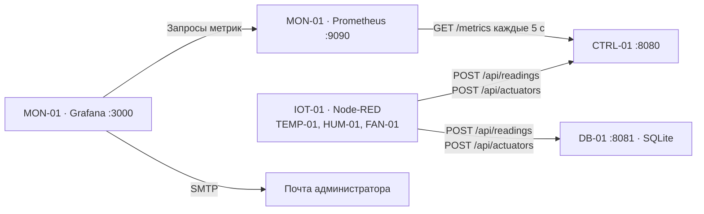

# Умный офис

Учебный виртуальный стенд для автоматического охлаждения серверной и наблюдения за состоянием помещения. В Node-RED моделируются датчики температуры `TEMP-01`, влажности `HUM-01` и вентилятор `FAN-01`. Показания поступают в HTTP-приёмник и SQLite, а Prometheus и Grafana обеспечивают мониторинг и оповещения.

**Группа:** 54-15 · **Специальность:** 09.02.08 «Интеллектуальные интегрированные системы» · **Модуль:** ПМ03 / МДК 03.01.

## Возможности

- Генерация температуры и влажности каждые 5 секунд.
- Автоматическое включение вентилятора при температуре **выше 30 °C** и выключение при **30 °C и ниже**.
- Параллельная отправка показаний и событий вентилятора на CTRL-01 и DB-01.
- Хранение истории в SQLite и просмотр через браузер.
- Панель Grafana с показаниями, состоянием вентилятора, режимом и возрастом данных.
- Раздельные оповещения о пропаже датчика и недоступности приёмника, отправка уведомлений по электронной почте.

Сохранённый поток реализует автоматический режим. Отдельного интерфейса ручного управления в нём нет.

## Состав и адреса стенда

Стенд моделируется в GNS3. Серверные узлы работают на РЕД ОС 8, рабочее место администратора — на Windows Server 2019.

| Узел | Назначение | IP-адрес | Порты TCP |
|---|---|---|---|
| IOT-01 | Node-RED: модели датчиков и вентилятора | `192.168.30.4/24` | `1880` |
| CTRL-01 | Node.js: приём телеметрии и экспорт метрик | `192.168.10.2/24` | `8080` |
| DB-01 | Python: HTTP API, SQLite, страница истории | `192.168.20.3/24` | `8081` |
| MON-01 | Prometheus и Grafana | `192.168.20.6/24` | `9090`, `3000` |
| WIN-01 | Браузер администратора | `192.168.10.5/24` | — |

Маска подсетей — `255.255.255.192`. Шлюзы: `192.168.10.1`, `192.168.20.1` и `192.168.30.1` соответственно.

В сохранённой конфигурации используется встроенный Ethernet Switch GNS3 с портами в VLAN 1 и маршрутизатор на РЕД ОС 8 с тремя адресами шлюзов на внутреннем интерфейсе. Это отличается от схемы с Cisco и тремя VLAN в исходном задании. Подробности: [узлы сети](practice7/configs/hosts.md), [маршрутизатор](practice7/configs/rtr.md).

### Веб-интерфейсы

Открываются с WIN-01 внутри виртуальной сети:

| Интерфейс | Адрес |
|---|---|
| Редактор Node-RED | [192.168.30.4:1880](http://192.168.30.14:1880/) |
| История показаний и событий FAN | [192.168.20.6:8081](http://192.168.20.13:8081/) |
| Проверка приёмника | [CTRL /health](http://192.168.10.2:8080/health) |
| Метрики приёмника | [CTRL /metrics](http://192.168.10.2:8080/metrics) |
| Prometheus | [192.168.20.12:9090](http://192.168.20.6:9090/) |
| Панель Grafana | [Office CTRL](http://192.168.20.6:3000/d/office-controller-lab) |
| Оповещения Grafana | [Правила](http://192.168.20.6:3000/alerting/list) |

## Обмен данными



CTRL хранит последние значения в памяти; после перезапуска они появятся при получении новых сообщений. История на DB сохраняется в `data/telemetry.sqlite3` через подключённый каталог контейнера.

## Файлы проекта

Основной комплект для развёртывания находится в **`practice7/`**. Каталоги предыдущих работ сохранены как материалы отдельных этапов.

| Путь | Содержимое |
|---|---|
| [practice7/ctrl/](practice7/ctrl/) | Приёмник `receiver.js` с `/metrics` и Docker Compose |
| [practice7/iot/](practice7/iot/) | Compose для Node-RED и экспорт рабочего потока `flows.json` |
| [practice7/db/](practice7/db/) | Сервис хранения, страница истории, Compose, SQL-схема и проверочные запросы |
| [practice7/monitoring/](practice7/monitoring/) | Prometheus, systemd unit, источник Grafana, панель и правила оповещения |
| [practice7/configs/](practice7/configs/) | Настройки сети, установка Docker и тестовый Compose Nginx |
| [practice7/docs/](practice7/docs/) | План офиса, таблица адресации, инструкция заказчику и описания работ |
| [practice7/docs/presentation/](practice7/docs/presentation/) | HTML-презентация; скачайте и откройте `presentation.html` в браузере |
| [practice7/evidence/](practice7/evidence/) | Скриншоты проверок |
| [practice7/journal.md](practice7/journal.md) | Журнал выполнения работ |
| [practice7/docs/test-journal.md](practice7/docs/test-journal.md) | Испытания, результаты и исправленные ошибки |
| `practice4/`, `practice5/`, `practice6/` | Материалы ранних версий датчиков, вентилятора и хранения |

## Запуск

Потребуются настроенная связность между ВМ, Docker и Docker Compose на IOT-01, CTRL-01 и DB-01. На MON-01 Prometheus и Grafana устанавливаются как **системные службы**, без Docker Compose.

Скопируйте каталоги `practice7/db`, `practice7/ctrl` и `practice7/iot` на соответствующие ВМ. Следующие команды выполняются в каталоге нужного сервиса. Если на стенде установлен отдельный Compose, используйте `docker-compose` вместо `docker compose`.

### 1. DB-01

```bash
sudo docker compose up -d
curl -fsS http://127.0.0.1:8081/health
```

Сервис создаёт таблицы при запуске; база хранится в локальном каталоге `data/`.

### 2. CTRL-01

Освободите порт 8080, если на нём ещё работает тестовый Nginx. Затем:

```bash
sudo docker compose up -d
curl -fsS http://127.0.0.1:8080/health
curl -fsS http://127.0.0.1:8080/metrics
```

В ответе `/health` ожидаются `status: ok` и `version: 3`.

### 3. IOT-01

```bash
sudo docker compose up -d
```

Откройте редактор Node-RED с WIN-01, импортируйте [flows.json](practice7/iot/flows.json), проверьте адреса CTRL и DB в узлах HTTP Request и нажмите **Deploy**. На новом экземпляре импорт выполняется один раз; при повторном запуске используйте уже сохранённый поток. Оба периодических узла отправки должны быть включены.

### 4. MON-01

Для восстановления мониторинга используйте [prometheus.yml](practice7/monitoring/prometheus.yml) и [prometheus.service](practice7/monitoring/prometheus.service). Перед установкой unit-файла проверьте пути, пользователя службы и права на каталог данных.

После размещения конфигурации Prometheus в `/etc/prometheus/prometheus.yml`:

```bash
promtool check config /etc/prometheus/prometheus.yml
sudo systemctl daemon-reload
sudo systemctl enable --now prometheus grafana-server
systemctl is-active prometheus grafana-server
```

В Grafana подключите Prometheus с UID `prometheus-office`, импортируйте `dashboard.json` и правила из `alert-rules.yaml`. Настройки лежат в [monitoring/](practice7/monitoring/). SMTP и контакт `email-admin` настраиваются отдельно на MON-01.

## Проверка работы

1. В Node-RED убедитесь, что CTRL отвечает `status: ok`, а DB — `status: stored`.
2. На странице истории проверьте новые строки TEMP-01, HUM-01 и FAN-01. SQL-запросы находятся в [queries.sql](practice7/db/queries.sql).
3. В Prometheus откройте **Status → Targets**: задача `office-controller` должна иметь статус **UP**. Интервал сбора — 5 секунд, тайм-аут — 4 секунды.
4. В Grafana проверьте температуру, влажность, FAN и возраст данных. При температуре 35 °C ожидается `ON`, при 25 °C — `OFF`.
5. Остановите только отправку TEMP-01. Через 35–45 секунд проверьте тревогу TEMP, рост возраста его показаний и продолжающееся обновление HUM при доступном CTRL. Восстановите отправку, дождитесь Normal и повторите для HUM-01.
6. Остановите контейнер приёмника CTRL: цель должна стать **DOWN**, а правило недоступности CTRL — перейти в Alerting. Затем запустите приёмник и дождитесь новых показаний.

Правила датчиков срабатывают при возрасте данных более 20 секунд **только при доступном CTRL**. Проверка выполняется каждые 10 секунд, Pending — 0 секунд. Недоступность CTRL отслеживается отдельно по `up`. Старые значения при остановленном приёмнике нельзя считать текущими.

Описание правил: [alert-rules.md](practice7/monitoring/alert-rules.md). Сохранённые результаты испытаний и доставки писем: [журнал испытаний](practice7/docs/test-journal.md). Доступ к работающим ВМ из этого репозитория не предоставляется.

## Данные и настройки

Пароли, ключи, SMTP-секреты, рабочую SQLite и каталоги данных контейнеров не следует добавлять в Git. Перед изменением стенда сохраняйте экспорт Node-RED и резервные копии настроек; перед удалением контейнеров или томов отдельно сохраняйте историю SQLite.
